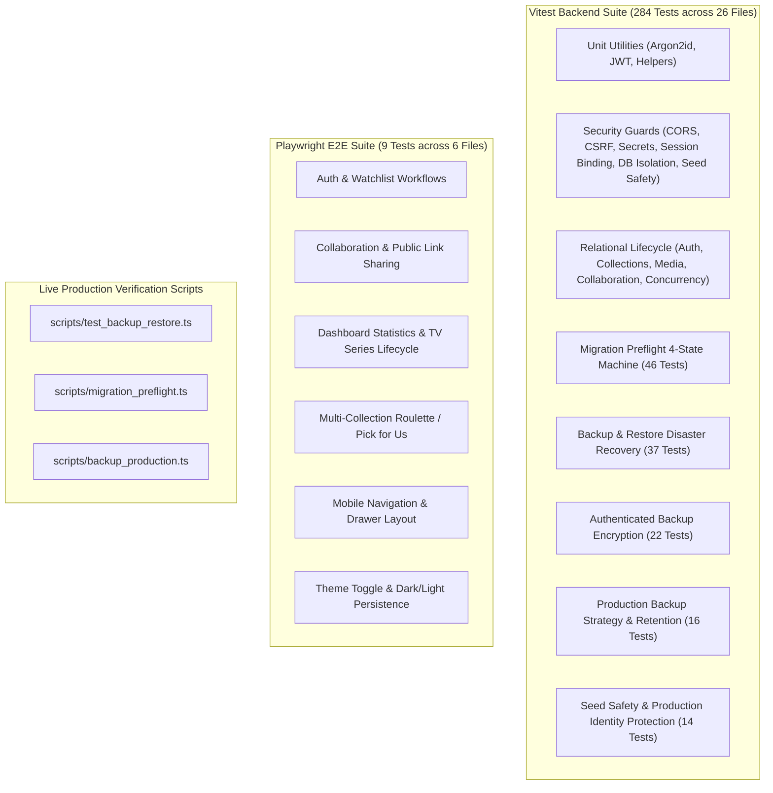

# CineTrack — Automated Testing Architecture & Execution Guide

**Project**: CineTrack  
**Test Frameworks**: Vitest 5.1 (Backend Unit & Integration) & Playwright 1.50+ (Frontend End-to-End)  
**Database**: Real PostgreSQL 18.6+ instances (Zero database mocking)  

---

## 1. Testing Philosophy & Architecture

CineTrack enforces a strict test reliability standard:
1. **Real PostgreSQL Instances Only**: No mocks or in-memory SQLite proxies are permitted for database operations. All tests execute against real PostgreSQL databases (`cinetrack_test` or disposable dynamic databases created on the fly).
2. **Zero Failures & Zero Suppressions**: 100% of tests must pass. No tests are skipped or ignored.
3. **Fail-Closed Failure Injection**: Tests actively simulate database crashes, corrupt dump files, client termination errors, and permission failures to guarantee fail-closed behavior.
4. **Guaranteed Test Cleanup**: Disposable databases and dump files are cleanly dropped and unlinked in structured `try/finally` blocks.



---

## 2. Test Execution Summary

| Test Domain | Runner | Executed Command | Total Suites | Total Tests | Passed | Failed | Skipped | Status |
|---|---|---|---|---|---|---|---|---|
| **Server Full Suite** | Vitest | `npm --prefix server run test` | **26** | **284** | **284** | 0 | 0 | **100% PASSED** |
| **Backup & Restore Safety** | Vitest | `npm --prefix server run test -- backup-restore` | 1 | 37 | 37 | 0 | 0 | **100% PASSED** |
| **Backup Authenticated Encryption** | Vitest | `npm --prefix server run test -- backup-crypto` | 1 | 22 | 22 | 0 | 0 | **100% PASSED** |
| **Production Backup & Retention** | Vitest | `npm --prefix server run test -- backup-production` | 1 | 16 | 16 | 0 | 0 | **100% PASSED** |
| **Migration Preflight States** | Vitest | `npm --prefix server run test -- migration-preflight-states` | 1 | 46 | 46 | 0 | 0 | **100% PASSED** |
| **Seed Safety & Identity Guards** | Vitest | `npm --prefix server run test -- seed-safety` | 1 | 14 | 14 | 0 | 0 | **100% PASSED** |
| **Concurrency & Status Semantics** | Vitest | `npm --prefix server run test -- concurrency` | 1 | 4 | 4 | 0 | 0 | **100% PASSED** |
| **Database Isolation Safety** | Vitest | `npm --prefix server run test -- db-isolation` | 1 | 18 | 18 | 0 | 0 | **100% PASSED** |
| **Frontend End-to-End** | Playwright | `npx playwright test` | 6 | 9 | 9 | 0 | 0 | **100% PASSED** |
| **Server TypeScript Check** | `tsc` | `npm --prefix server run typecheck` | 1 | — | 0 errors | 0 | 0 | **100% PASSED** |
| **Client TypeScript Check** | `tsc` | `npm --prefix client run typecheck` | 1 | — | 0 errors | 0 | 0 | **100% PASSED** |
| **Client ESLint Gate** | ESLint | `npm --prefix client run lint` | 1 | — | 0 errors | 0 | 0 | **100% PASSED** |
| **Server Production Build** | `tsc` | `npm --prefix server run build` | 1 | — | 0 errors | 0 | 0 | **100% PASSED** |
| **Client Production Build** | Vite | `npm --prefix client run build` | 1 | — | 0 errors | 0 | 0 | **100% PASSED** |
| **Live Backup Verification** | tsx | `npm --prefix server run db:test-backup` | 1 | — | Verified | 0 | 0 | **100% PASSED** |
| **Live Preflight Verification** | tsx | `npm --prefix server run prisma:preflight` | 1 | — | `[State: VALID]` | 0 | 0 | **100% PASSED** |

---

## 3. Server Test Suite Matrix (254 Tests across 25 Test Files)

1. **`tests/migration-preflight-states.test.ts` (43 tests)**:
   - State A (`EMPTY`): Fresh database with 0 tables, 0 views, 0 matviews, 0 sequences, 0 types, 0 routines.
   - State B (`VALID`): Fully initialized schema with clean relational data.
   - State B (`VALID`): Verified disk migrations match applied migrations.
   - State C (`PARTIAL`): Dropped core tables (`User`, `Collection`, `CollectionMovie`), missing `_prisma_migrations`, missing columns on tables, column data type mismatches, column default expression mismatches, unexpected extra columns, failed or rolled back migrations.
   - State D (`INCONSISTENT`): Leftover views, leftover materialized views, leftover sequences, leftover custom types, leftover routines, unrelated tables, duplicate migration rows, migration checksum mismatch, missing foreign keys, missing CHECK constraint, missing unique index, missing partial index predicates, missing enum types, unexpected enum values, duplicate usernames, duplicate emails, multiple default watchlists, orphaned foreign keys, missing migration directory, empty migration directory, missing migration.sql, foreign key delete action mismatch (NO ACTION vs CASCADE), invalid check constraint definitions, inverted partial index predicates (`isDefaultWatchlist = false`), and invalid indexes (`indisvalid = false`).

2. **`tests/backup-restore.test.ts` (34 tests)**:
   - Fails closed on missing `BACKUP_TEST_SOURCE_URL` or missing parameters.
   - Strict immutable host allowlisting (`localhost`, `127.0.0.1`, `::1`, `postgres`, `host.docker.internal`).
   - Strict immutable test database allowlisting (`cinetrack_test`, `cinetrack_ci`, `cinetrack_e2e`).
   - Host mismatch prevention between source and admin URLs.
   - Rejection of production database names (`cinetrack`, `prod`, `live`) and substring traps (`contest`, `protest`).
   - Live socket identity verification (`inet_server_addr()`, `current_database()`) with fail-closed enforcement when socket addresses cannot be resolved.
   - Process-owned disposable restore database tracking ensuring cleanup can only drop the exact database instance created by the run.
   - Bidirectional schema comparison: missing/extra tables, columns, nullability, defaults, constraints, indexes, enums.
   - True keyset-chunked table hashing (`computeTableChunkedHash`) bounded at 500 rows per batch using dynamic primary keys and composite row-value comparison `(pk1, pk2) > ($1, $2)` in a `REPEATABLE READ READ ONLY` snapshot with streaming SHA-256 in Node.js (zero `OFFSET`).
   - Preservation of caller-owned custom dump paths (`options.customDumpPath`).
   - Failure injection: simulated pg_dump failures, restore failures, verification assertion failures, dump cleanup failures, database drop failures, and client shutdown failures.
   - Proof that unrelated databases are unaffected.
   - Live end-to-end backup, restore, schema match, and relational usability execution.

3. **`tests/cors-validation.test.ts` (19 tests)**:
   - Validates explicit HTTPS origins, comma-separated lists, and fails closed on HTTP schemes, wildcards (`*`), localhost, private IPv4/IPv6 ranges, paths, queries, and hash fragments in production.

4. **`tests/db-isolation.test.ts` (18 tests)**:
   - Prevents `TARGET_DATABASE_URL` override in application database connection resolution.
   - Strictly requires `TEST_DATABASE_URL` in test mode and validates against immutable approved test databases (`cinetrack_test`, `cinetrack_ci`, `cinetrack_e2e`).
   - Proves environment variables (`EXPECTED_TEST_DATABASE_NAME`, `TEST_APPROVED_HOSTS`) cannot expand the immutable allowlist.
   - Rejects production database names (`cinetrack`, `cinetrack_production`, `prod`, `live`) in test mode.
   - Rejects test databases in production mode.
   - Rejects unapproved remote hosts and validates live connected server identity (`inet_server_addr()`, `current_database()`).

5. **`tests/csrf.test.ts` (16 tests)**:
   - Validates HMAC token generation, double-submit cookie verification, header matching, safe GET requests, rejection of missing tokens, expired tokens, invalid signatures, and protected state-changing routes.

6. **`tests/auth-refresh.test.ts` (14 tests)**:
   - Validates refresh token rotation, cookie-only acceptance, rejection of body/bearer tokens, atomic `FOR UPDATE` lock, token reuse detection, 10-second grace period, and user profile loading.

7. **`tests/mandatory-session.test.ts` (13 tests)**:
   - Validates mandatory `sessionId` claim in access tokens, database session lookup on each request, session expiry enforcement, revoked session rejection, and fail-closed behavior on database error.

8. **`tests/backup-crypto.test.ts` (12 tests)**:
   - Round-trip file encryption and decryption with SHA-256 byte digest matching.
   - Large multi-megabyte binary dumps stream encryption without memory exhaustion.
   - Rejection on incorrect passphrase (auth tag verification failure).
   - Rejection on corrupted ciphertext bytes (single bit-flip detection).
   - Rejection on tampered authentication tag.
   - Rejection on tampered IV and Salt.
   - Rejection on corrupted or invalid magic header (`CTBK01`).
   - Rejection on truncated file (< 50 bytes header).
   - Rejection on empty or missing passphrase.
   - Rejection on non-existent source file.
   - Header inspection for valid metadata.

9. **`tests/secrets-validation.test.ts` (12 tests)**:
   - Validates pairwise distinct secrets in production, minimum 32-character requirement, and rejection of weak/placeholder strings (`replace_with`, `password`, `cinetrack_dev`).

10. **`tests/unit/utils.test.ts` (10 tests)**:
    - Tests Argon2id password hashing, verification, invalid hash handling, JWT creation, JWT verification, and response helpers.

11. **`tests/logout-reliability.test.ts` (7 tests)**:
    - Tests successful logout, database session revocation (`revokedAt = NOW()`), idempotent repeated logout, rejection of revoked tokens, invalid token handling, fail-closed HTTP 500 error propagation on database failure, and cookie clearing.

12. **`tests/auth.test.ts` (6 tests)**:
    - Tests user registration, password hashing, login with email or username, duplicate username rejection, invalid password rejection, and session persistence.

13. **`tests/collections.test.ts` (6 tests)**:
    - Tests creation of custom collections, default watchlist retrieval, collection updates, and collection deletion safeguards.

14. **`tests/tmdb.test.ts` (6 tests)**:
    - Tests movie search, TV search, details retrieval, caching, rate limiting, and fallback behavior.

15. **`tests/stats.test.ts` (5 tests)**:
    - Tests collection-aware dashboard statistics, watched hours calculation, TV episode tracking, and genre distribution calculations.

16. **`tests/concurrency.test.ts` (4 tests)**:
    - Race condition handling in `MovieService.getOrCreateMovie` under concurrent requests.
    - Race condition handling in `CollectionMovieService.addMovie` (one succeeds, others return 409 ConflictError).
    - Concurrent `getUserDefaultWatchlist` creation without duplicate watchlist collisions.
    - Multi-collection watch status independence: movie marked as watched in Collection A remains unwatched in Collection B.

17. **`tests/case-insensitive-auth.test.ts` (4 tests)**:
    - Tests case-insensitive username authentication.
    - Tests case-insensitive email authentication.
    - Tests database-level partial unique constraint rejecting duplicate default watchlists.
    - Tests PostgreSQL database-level CHECK constraint enforcing `CollectionMovie.status` and `watchedAt` consistency (error code `23514`).

18. **`tests/multiRoulette.test.ts` (4 tests)**:
    - Tests multi-collection roulette selection, unwatched filtering, weighted random selection, and empty collection handling.

19. **`tests/collaboration.test.ts` (3 tests)**:
    - Tests invitation creation, acceptance, decline, member listing, and permission enforcement for collaborators.

20. **`tests/security-guards.test.ts` (3 tests)**:
    - Tests database preflight diagnostics, test environment guards, and production seeding locks.

21. **`tests/sharing.test.ts` (2 tests)**:
    - Tests public collection share link generation, revocation, and unauthenticated read-only access.

22. **`tests/roulette.test.ts` (2 tests)**:
    - Tests single-collection roulette and unwatched item filtering.

23. **`tests/roulette-validation.test.ts` (2 tests)**:
    - Tests input validation, empty collection handling, and parameter bounds for roulette endpoints.

24. **`tests/public-privacy.test.ts` (1 test)**:
    - Tests exclusion of private personal notes, collaborator emails, and internal metadata from public collection responses.

---

## 4. Running the Tests Locally

```bash
# Run Vitest test suite against real PostgreSQL test database
npm --prefix server run test

# Run specific test suites
npm --prefix server run test -- backup-restore
npm --prefix server run test -- backup-crypto
npm --prefix server run test -- concurrency
npm --prefix server run test -- migration-preflight-states

# Run live non-destructive backup and restore verification
npm --prefix server run db:test-backup

# Run live migration preflight diagnostics
npm --prefix server run prisma:preflight

# Run Playwright End-to-End browser tests
npx playwright test
```
